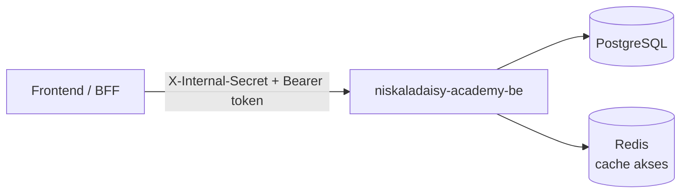
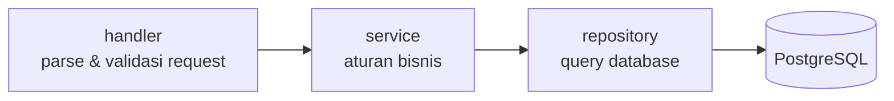
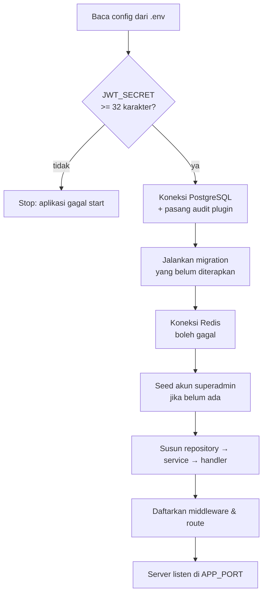
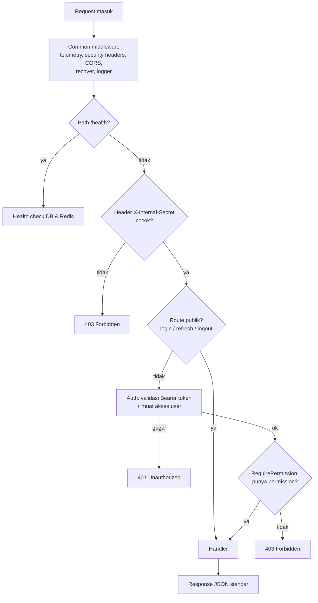
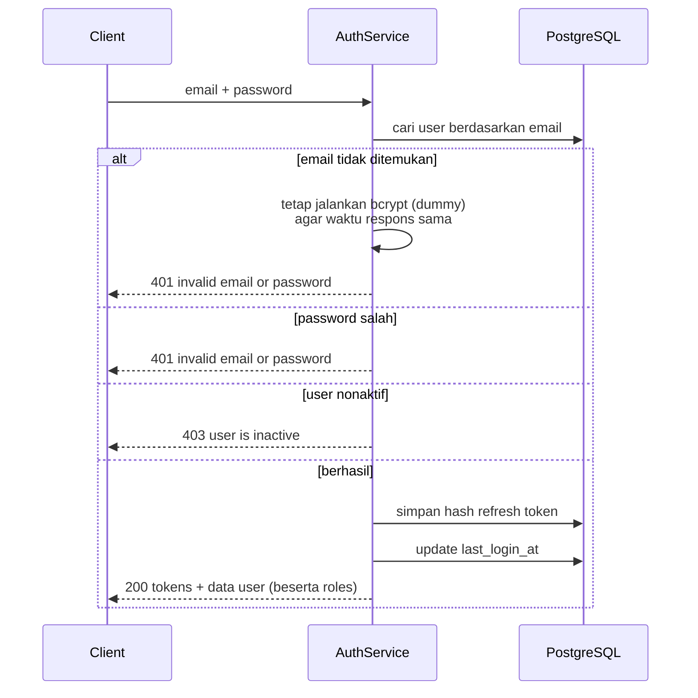
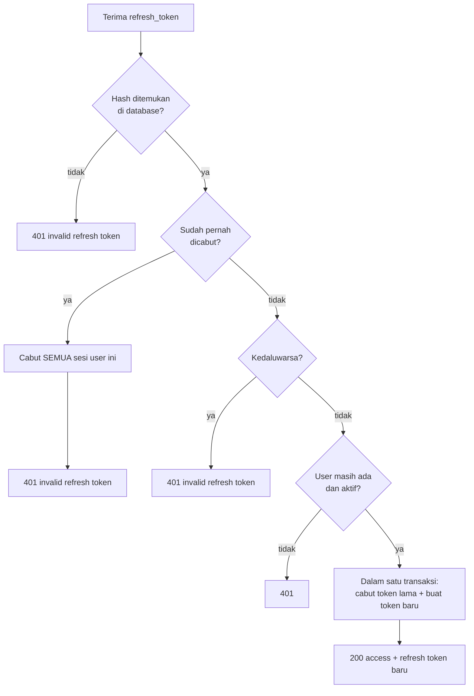
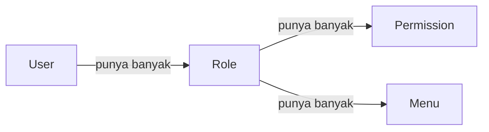
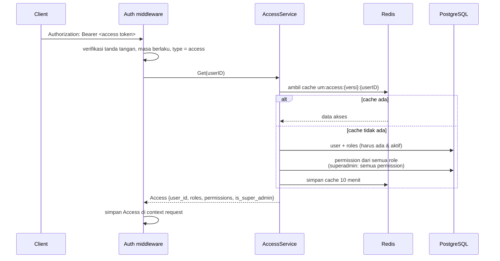
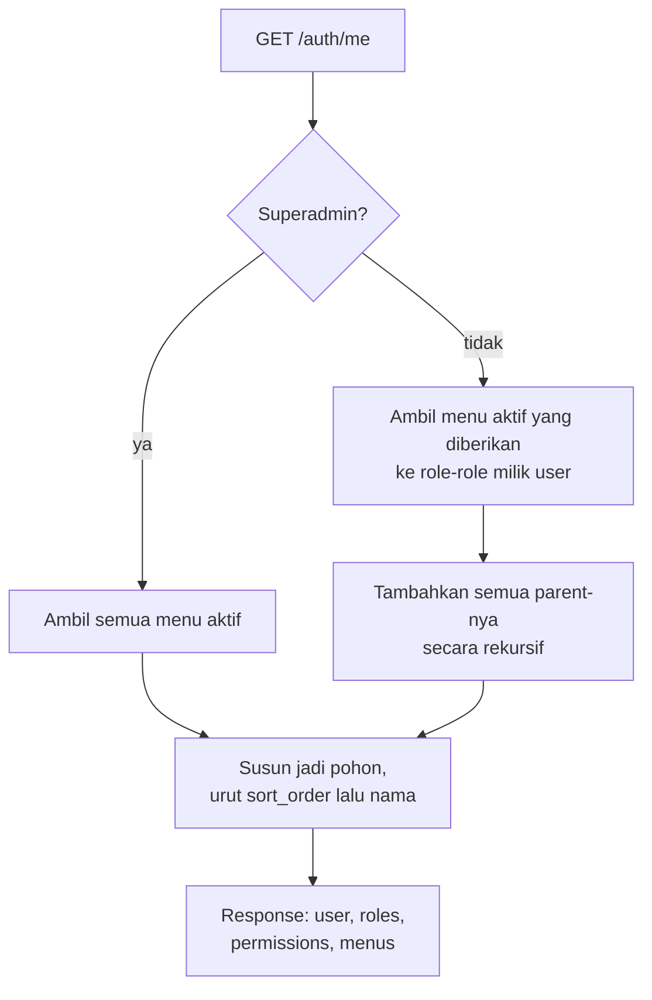
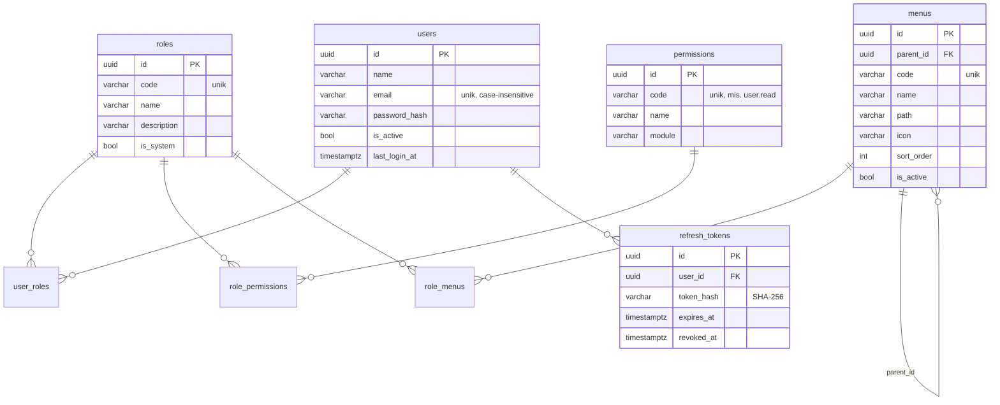

# Alur Aplikasi — niskaladaisy-academy-be

Dokumen ini menjelaskan cara kerja backend Niskala Daisy Academy: dari aplikasi menyala, request masuk, login, sampai pengecekan role, permission, dan menu.

## Daftar Isi
1. [Gambaran Umum](#1-gambaran-umum)
2. [Struktur Folder](#2-struktur-folder)
3. [Alur Startup](#3-alur-startup)
4. [Alur Sebuah Request](#4-alur-sebuah-request)
5. [Autentikasi (Login, Refresh, Logout)](#5-autentikasi)
6. [Otorisasi (Role & Permission)](#6-otorisasi-role--permission)
7. [Akses Menu](#7-akses-menu)
8. [Manajemen User, Role, dan Menu](#8-manajemen-user-role-dan-menu)
9. [Model Data](#9-model-data)
10. [Daftar Endpoint](#10-daftar-endpoint)
11. [Format Response & Error](#11-format-response--error)
12. [Konfigurasi](#12-konfigurasi)
13. [Menjalankan Aplikasi](#13-menjalankan-aplikasi)

---

## 1. Gambaran Umum

Service ini ditulis dengan **Go + Fiber**, memakai **PostgreSQL** (via GORM) sebagai database utama dan **Redis** sebagai cache. Utilitas bersama (response, logger, middleware, audit, transaksi) berasal dari library [`go-common`](https://github.com/yuusufyan/go-common).

Service ini menangani sendiri:
- **Autentikasi**: login email + password, access token (JWT) dan refresh token.
- **Otorisasi**: user punya satu atau lebih *role*, role punya kumpulan *permission*. Setiap endpoint dijaga oleh permission tertentu.
- **Akses menu**: setiap role diberi daftar menu yang boleh dibuka. Frontend menyusun sidebar dari data ini.



---

## 2. Struktur Folder

```
cmd/api/main.go              Titik masuk: wiring semua komponen dan menyalakan server
internal/
  config/                    Membaca konfigurasi dari .env / environment variable
  migration/
    migrate.go               Menjalankan migration (goose) saat startup
    migrations/*.sql         Skema tabel + data awal (permission, menu, role superadmin)
  model/                     Entitas GORM: User, Role, Permission, Menu, RefreshToken
  repository/                Query ke database, satu file per entitas: <nama>.repository.go
  service/                   Logika bisnis: <nama>.service.go (auth, access, user, role, menu)
                             errors.go berisi helper bersama (error & pagination)
  middleware/                Auth (validasi token) dan RequirePermission: <nama>.middleware.go
  handler/                   Handler HTTP: <nama>.handler.go
                             handler.go berisi helper bersama, router.go mendaftarkan route
  seed/                      Membuat akun superadmin pertama
```

Konvensi penamaan file: file di `service/`, `repository/`, `handler/`, dan `middleware/` diberi akhiran sesuai lapisannya, misalnya `user.service.go`, `user.repository.go`, `user.handler.go`. Saat menambah modul baru (misalnya kursus), buat `course.repository.go`, `course.service.go`, dan `course.handler.go`.

Pembagian tanggung jawabnya berlapis:



- **handler** hanya membaca request, memvalidasi input, memanggil service, lalu mengirim response.
- **service** berisi aturan bisnis (misalnya "user tidak boleh menghapus dirinya sendiri") dan mengatur transaksi.
- **repository** hanya berisi query. Setiap query memakai `database.GetDBFromContext`, sehingga otomatis ikut transaksi yang sedang berjalan.

---

## 3. Alur Startup

Urutan yang dijalankan [`cmd/api/main.go`](../cmd/api/main.go) saat aplikasi menyala:



Catatan:
- **Migration** dijalankan otomatis setiap startup. Migration yang sudah pernah diterapkan dilewati (dicatat goose di tabel `goose_db_version`).
- **Redis bersifat opsional.** Kalau Redis tidak tersedia, aplikasi tetap jalan; hanya cache akses yang nonaktif, sehingga setiap request membaca langsung dari database.
- **Seed superadmin** hanya membuat akun jika `SEED_ADMIN_EMAIL` dan `SEED_ADMIN_PASSWORD` diisi dan email tersebut belum terdaftar. Akun yang sudah ada tidak pernah diubah, jadi mengganti `.env` belakangan tidak akan me-reset password.
- Saat aplikasi dimatikan (SIGINT/SIGTERM), server HTTP berhenti menerima request dulu, baru kemudian koneksi database dan Redis ditutup.

---

## 4. Alur Sebuah Request

Setiap request melewati lapisan middleware berikut secara berurutan:



Penjelasan tiap lapisan:

| Lapisan | Fungsi |
|---|---|
| **Common middleware** (dari `go-common`) | Menambahkan `X-Request-ID`/`X-Trace-ID`, header keamanan, CORS, menangkap panic, dan mencatat log request. |
| **`/health`** | Didaftarkan sebelum pengecekan secret, supaya bisa diakses oleh health probe. |
| **InternalSecret** | Menolak request yang tidak membawa header `X-Internal-Secret` yang sama dengan `INTERNAL_SERVICE_SECRET`. Tujuannya agar service hanya bisa dipanggil lewat BFF/gateway tepercaya, **termasuk endpoint login**. |
| **Auth** | Memvalidasi access token, lalu memuat akses user terbaru (lihat [bagian 6](#6-otorisasi-role--permission)). |
| **RequirePermission** | Mengecek apakah user punya permission yang dibutuhkan route tersebut. |

> **Penting untuk frontend:** jika frontend memanggil API ini langsung dari browser (tanpa BFF), middleware InternalSecret perlu dilepas dari route `/api`, karena secret tidak boleh disimpan di browser.

---

## 5. Autentikasi

Ada dua jenis token:

| Token | Bentuk | Masa berlaku | Disimpan di server? |
|---|---|---|---|
| **Access token** | JWT (HS256), berisi `sub` = ID user, `type` = `access` | 15 menit (`JWT_ACCESS_TTL`) | Tidak |
| **Refresh token** | String acak 32 byte | 7 hari (`JWT_REFRESH_TTL`) | Ya, **hanya hash SHA-256-nya** di tabel `refresh_tokens` |

Access token dikirim di setiap request sebagai `Authorization: Bearer <token>`. Refresh token hanya dipakai untuk meminta access token baru.

### 5.1 Login — `POST /api/v1/auth/login`



Pesan error untuk email tidak terdaftar dan password salah dibuat **sama persis**, dan waktu prosesnya disamakan, supaya penyerang tidak bisa menebak email mana yang terdaftar.

### 5.2 Refresh token — `POST /api/v1/auth/refresh`

Setiap kali refresh token dipakai, token lama **dicabut** dan diganti token baru (*rotation*).



**Kenapa token yang sudah dicabut memicu pencabutan semua sesi?** Refresh token yang sah hanya dipakai sekali. Kalau token lama dipakai lagi, kemungkinan besar token itu dicuri. Dengan mencabut semua sesi, pencuri dan user asli sama-sama harus login ulang, dan pencuri tidak bisa melanjutkan sesinya.

Jika dua request refresh memakai token yang sama secara bersamaan, hanya satu yang berhasil; yang lain mendapat 401.

### 5.3 Logout — `POST /api/v1/auth/logout`

Mencabut refresh token yang dikirim. Token yang tidak dikenal diabaikan, jadi logout selalu berhasil (200). Access token yang sudah terlanjur dipegang client tetap berlaku sampai kedaluwarsa (maksimal 15 menit); frontend cukup menghapusnya dari penyimpanan.

### 5.4 Ganti password sendiri — `PUT /api/v1/auth/me/password`

User mengirim `current_password` dan `new_password` (minimal 8 karakter). Jika password lama benar, password diganti dan **semua refresh token user dicabut**, sehingga user perlu login ulang di semua perangkat.

---

## 6. Otorisasi (Role & Permission)

### 6.1 Konsep



- **Permission** adalah izin untuk satu aksi, dengan format `<modul>.<aksi>`, misalnya `user.read` atau `role.update`. Daftar permission **ditentukan oleh kode** (dipakai untuk menjaga route), sehingga dibuat lewat migration dan **tidak bisa ditambah atau diubah lewat API**.
- **Role** adalah kumpulan permission dan menu. Role bisa dibuat dan diatur bebas lewat API.
- Seorang user bisa punya **lebih dari satu role**. Permission efektifnya adalah **gabungan** permission dari semua role-nya.
- Role **`superadmin`** adalah role sistem: otomatis lolos semua pengecekan permission dan melihat semua menu aktif, tanpa perlu dipetakan.

### 6.2 Bagaimana akses user dimuat

Setiap request terautentikasi melewati middleware **Auth** ([`internal/middleware/auth.middleware.go`](../internal/middleware/auth.middleware.go)):



Hal penting dari desain ini:
- **Permission tidak disimpan di dalam token.** Token hanya berisi ID user; permission dibaca dari database (atau cache) di setiap request. Akibatnya, **perubahan role, permission, status aktif, atau penghapusan user langsung berlaku di request berikutnya**, tanpa menunggu token kedaluwarsa dan tanpa login ulang.
- **Invalidasi cache dibuat sederhana:** setiap ada perubahan pada user, role, atau menu, nilai `um:access:version` di Redis dinaikkan satu. Karena versi menjadi bagian dari key cache, semua cache lama otomatis tidak terpakai lagi.
- Data `Access` juga dipakai **audit plugin** untuk mengisi kolom `created_by` dan `updated_by` secara otomatis.

### 6.3 Pengecekan permission per route

Route didaftarkan di [`internal/handler/router.go`](../internal/handler/router.go), contohnya:

```go
users.Post("/", perm(model.PermUserCreate), h.User.Create)
```

`RequirePermission` mengizinkan request jika user adalah superadmin **atau** punya salah satu permission yang disebutkan. Jika tidak, response-nya `403 Forbidden`.

### 6.4 Menambah permission baru (untuk developer)

Saat membuat fitur baru, misalnya modul kursus:
1. Tambahkan konstanta di [`internal/model/permission.go`](../internal/model/permission.go), misalnya `PermCourseRead = "course.read"`.
2. Buat file migration baru di `internal/migration/migrations/` (misalnya `00003_seed_course_permissions.sql`) yang meng-`INSERT` permission tersebut. **Jangan mengubah file migration yang sudah pernah dijalankan.**
3. Pasang `perm(model.PermCourseRead)` di route-nya.
4. Berikan permission itu ke role yang sesuai lewat `PUT /api/v1/roles/:id`.

---

## 7. Akses Menu

Menu disusun sebagai **pohon** (menu bisa punya sub-menu lewat `parent_id`). Akses menu diatur **per role** melalui tabel `role_menus`.

Frontend mendapatkan menu yang boleh ditampilkan dari **`GET /api/v1/auth/me`**:



Aturan yang perlu diketahui:
- **Parent otomatis ikut.** Jika role hanya diberi menu "Users", menu induknya "User Management" tetap ikut dikirim, supaya pohon menu di frontend utuh.
- **Menu nonaktif menyembunyikan seluruh cabangnya.** Jika "User Management" dinonaktifkan, semua sub-menunya ikut tersembunyi.
- **Menu dan permission adalah dua hal terpisah.** Menu hanya mengatur apa yang *tampil* di navigasi; permission yang menentukan apa yang *boleh dilakukan* di API. Saat membuat role, pastikan keduanya diatur selaras (misalnya role yang diberi menu "Users" juga diberi `user.read`).

Contoh response `GET /auth/me`:

```json
{
  "code": 200,
  "status": "success",
  "message": "Success",
  "data": {
    "user": { "id": "…", "name": "Budi", "email": "budi@example.com", "is_active": true, "roles": [ … ] },
    "roles": ["admin_akademik"],
    "permissions": ["user.read", "user.update"],
    "menus": [
      { "code": "dashboard", "name": "Dashboard", "path": "/dashboard", "icon": "layout-dashboard", "children": [] },
      {
        "code": "user_management", "name": "User Management", "path": "", "icon": "users",
        "children": [
          { "code": "users", "name": "Users", "path": "/user-management/users", "icon": "user", "children": [] }
        ]
      }
    ]
  }
}
```

Frontend sebaiknya memakai `menus` untuk menyusun sidebar dan `permissions` untuk menyembunyikan tombol (misalnya tombol "Hapus" hanya tampil jika ada `user.delete`). Pengecekan sebenarnya tetap terjadi di backend.

---

## 8. Manajemen User, Role, dan Menu

### 8.1 User

| Aksi | Aturan |
|---|---|
| Buat user | Email harus unik (tidak peka huruf besar/kecil). Password 8–72 karakter, disimpan sebagai hash bcrypt. Role bisa langsung diberikan lewat `role_ids`. |
| Ubah user | Jika `role_ids` **tidak dikirim**, role user tidak diubah. Jika dikirim (termasuk `[]`), role diganti persis sesuai isinya. |
| Nonaktifkan user | Semua refresh token user dicabut dan cache akses di-invalidasi, sehingga user langsung tidak bisa mengakses API. |
| Reset password (oleh admin) | Password diganti dan semua sesi user dicabut. |
| Hapus user | *Soft delete* (kolom `deleted_at`), semua sesi dicabut. |

Aturan keamanan tambahan:
- **Hanya superadmin yang bisa memberikan role sistem** (seperti `superadmin`). Tanpa aturan ini, siapa pun yang punya `user.update` bisa menjadikan dirinya superadmin.
- **Hanya superadmin yang bisa mengubah, me-reset password, atau menghapus akun superadmin.**
- User **tidak bisa menghapus atau menonaktifkan dirinya sendiri**.
- Superadmin **tidak bisa mencabut role superadmin dari dirinya sendiri**, agar sistem tidak terkunci tanpa superadmin.

### 8.2 Role

| Aksi | Aturan |
|---|---|
| Buat role | `code` wajib unik, huruf kecil/angka/underscore dan diawali huruf (misalnya `admin_akademik`). Permission dan menu bisa langsung diberikan lewat `permission_ids` dan `menu_ids`. |
| Ubah role | `code` **tidak bisa diubah**. Jika `permission_ids`/`menu_ids` tidak dikirim, nilainya tidak diubah. |
| Hapus role | Ditolak (409) jika role masih dipakai user. Pindahkan user ke role lain dulu. |
| Role sistem | `superadmin` tidak bisa diubah maupun dihapus. |

### 8.3 Menu

| Aksi | Aturan |
|---|---|
| Buat / ubah menu | `code` unik dengan format yang sama seperti role. `parent_id` harus menunjuk menu yang ada, tidak boleh dirinya sendiri, dan tidak boleh sub-menunya sendiri (mencegah lingkaran). |
| Hapus menu | Ditolak (409) jika masih punya sub-menu. Menu yang dihapus otomatis dilepas dari semua role. |

---

## 9. Model Data



- Tabel `users`, `roles`, dan `menus` memakai **soft delete** dan kolom audit (`created_at`, `updated_at`, `created_by`, `updated_by`). `created_by`/`updated_by` diisi otomatis dengan ID user yang sedang login.
- `permissions` hanya diisi lewat migration.
- Data awal dari migration:
  - 13 permission: `user.*`, `role.*`, `permission.read`, `menu.*`
  - Role `superadmin`
  - Menu: **Dashboard**, dan **User Management** dengan sub-menu **Users**, **Roles**, **Menus**

---

## 10. Daftar Endpoint

Semua endpoint di bawah prefix `/api/v1` dan wajib membawa header `X-Internal-Secret`.

### Autentikasi
| Method | Path | Akses | Body |
|---|---|---|---|
| POST | `/auth/login` | publik | `email`, `password` |
| POST | `/auth/refresh` | publik | `refresh_token` |
| POST | `/auth/logout` | publik | `refresh_token` |
| GET | `/auth/me` | login | – |
| PUT | `/auth/me/password` | login | `current_password`, `new_password` |

### User
| Method | Path | Permission | Keterangan |
|---|---|---|---|
| GET | `/users` | `user.read` | Query: `search`, `is_active`, `page`, `limit` |
| GET | `/users/:id` | `user.read` | |
| POST | `/users` | `user.create` | `name`, `email`, `password`, `is_active?`, `role_ids?` |
| PUT | `/users/:id` | `user.update` | `name`, `email`, `is_active?`, `role_ids?` |
| PUT | `/users/:id/password` | `user.update` | `new_password` |
| DELETE | `/users/:id` | `user.delete` | |

### Role & Permission
| Method | Path | Permission | Keterangan |
|---|---|---|---|
| GET | `/roles` | `role.read` | Query: `search`, `page`, `limit` |
| GET | `/roles/:id` | `role.read` | Termasuk daftar permission dan menu |
| POST | `/roles` | `role.create` | `code`, `name`, `description?`, `permission_ids?`, `menu_ids?` |
| PUT | `/roles/:id` | `role.update` | `name`, `description?`, `permission_ids?`, `menu_ids?` |
| DELETE | `/roles/:id` | `role.delete` | |
| GET | `/permissions` | `permission.read` | Semua permission, urut per modul |

### Menu
| Method | Path | Permission | Keterangan |
|---|---|---|---|
| GET | `/menus` | `menu.read` | Pohon semua menu, termasuk yang nonaktif |
| GET | `/menus/:id` | `menu.read` | |
| POST | `/menus` | `menu.create` | `code`, `name`, `parent_id?`, `path?`, `icon?`, `sort_order?`, `is_active?` |
| PUT | `/menus/:id` | `menu.update` | Sama seperti create |
| DELETE | `/menus/:id` | `menu.delete` | |

### Lainnya
| Method | Path | Keterangan |
|---|---|---|
| GET | `/health` | Status DB & Redis, tanpa secret |
| GET | `/api/v1/ping` | Cek cepat, butuh secret |

Pagination: `page` minimal 1 (default 1), `limit` 1–100 (default 10).

---

## 11. Format Response & Error

Semua response memakai envelope standar dari `go-common`:

```json
{ "code": 200, "status": "success", "message": "Success", "data": { }, "meta": { } }
```

`meta` hanya ada di response berpagination:

```json
"meta": { "total": 42, "page": 1, "limit": 10, "total_pages": 5, "total_results": 42 }
```

Error validasi menyertakan detail per field (memakai nama field JSON):

```json
{
  "code": 400,
  "status": "error",
  "message": "Validation failed",
  "data": { "email": "Invalid email address for field email" }
}
```

| Kode | Arti |
|---|---|
| 400 | Input tidak valid atau melanggar aturan (misalnya menghapus diri sendiri) |
| 401 | Token tidak ada, salah, kedaluwarsa, atau user sudah nonaktif/dihapus |
| 403 | Secret internal salah, tidak punya permission, atau aksi khusus superadmin |
| 404 | Data tidak ditemukan |
| 409 | Konflik: email/code sudah dipakai, role masih dipakai user, menu masih punya sub-menu |
| 500 | Kesalahan server (detail hanya dicatat di log) |

---

## 12. Konfigurasi

Semua konfigurasi dibaca dari environment variable; file `.env` di root project dimuat otomatis.

| Key | Default | Keterangan |
|---|---|---|
| `APP_NAME` | `niskaladaisy-academy-be` | Nama service di log |
| `APP_ENV` | `development` | `production` mengaktifkan log JSON |
| `APP_PORT` | `8080` | |
| `DB_HOST`, `DB_PORT`, `DB_USER`, `DB_PASSWORD`, `DB_NAME` | `localhost`, `5432`, `postgres`, –, `niskaladaisy_academy` | Koneksi PostgreSQL |
| `DB_SSLMODE` | `disable` | |
| `DB_TIMEZONE` | `Asia/Jakarta` | |
| `REDIS_HOST`, `REDIS_PORT`, `REDIS_PASSWORD`, `REDIS_DB` | `localhost`, `6379`, –, `0` | Opsional |
| `INTERNAL_SERVICE_SECRET` | – | Nilai yang wajib dikirim di header `X-Internal-Secret` |
| `JWT_SECRET` | – | **Wajib**, minimal 32 karakter. Aplikasi menolak start jika kurang. |
| `JWT_ACCESS_TTL` | `15m` | Format durasi Go, misalnya `15m`, `1h` |
| `JWT_REFRESH_TTL` | `168h` | 7 hari |
| `SEED_ADMIN_NAME` | `Super Admin` | |
| `SEED_ADMIN_EMAIL`, `SEED_ADMIN_PASSWORD` | – | Jika diisi, akun superadmin dibuat saat startup (hanya jika belum ada) |

> Ganti password akun seed segera setelah login pertama, lewat `PUT /api/v1/auth/me/password`.

---

## 13. Menjalankan Aplikasi

Di laptop pengembangan berbasis Windows dengan kebijakan keamanan kantor, file `.exe` hasil `go build` bisa diblokir oleh Microsoft Defender. Karena itu aplikasi dijalankan di **Docker** atau **WSL**, bukan langsung di Windows.

**Lewat Docker Compose**

```bash
docker compose up --build
```

Pastikan `DB_HOST` dan `REDIS_HOST` di `.env` mengarah ke host yang bisa dijangkau dari dalam container (bukan `localhost`).

**Lewat WSL dengan hot reload (Air)**

```bash
cd /mnt/d/Berdua/niskala-daisy-aca/niskaladaisy-academy-be
air
```

Air membaca [`.air.toml`](../.air.toml) dan otomatis rebuild setiap file `.go` atau `.env` berubah.

**Coba login**

```bash
curl -X POST http://localhost:8080/api/v1/auth/login \
  -H "Content-Type: application/json" \
  -H "X-Internal-Secret: <isi INTERNAL_SERVICE_SECRET>" \
  -d '{"email":"<SEED_ADMIN_EMAIL>","password":"<SEED_ADMIN_PASSWORD>"}'
```

Ambil `data.tokens.access.token` dari response, lalu panggil endpoint lain dengan header `Authorization: Bearer <token>`.
